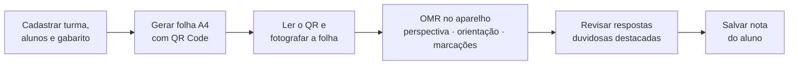

<div align="center">

# Corretor de Provas

**Da folha impressa à nota revisada, no próprio celular.**

Aplicativo Flutter para organizar turmas, alunos e provas objetivas, gerar folhas de respostas em PDF
e corrigir por leitura óptica (OMR) no aparelho, sem enviar fotos a servidores.


[Como funciona](#como-funciona) · [Recursos](#recursos) · [Leitura local](#leitura-local) · [Testes](#testes-e-integração) · [Arquitetura do scanner](docs/scanner.md)

</div>

## Como funciona



<table>
  <tr>
    <td width="42%"></td>
    <td>
      <b>A folha que o próprio app gera</b><br><br>
      Os quatro quadrados dos cantos permitem corrigir a perspectiva da foto; um padrão adicional
      identifica a orientação. O QR Code amarra a folha à prova e ao aluno, e o gerador de PDF e o
      leitor compartilham a mesma definição de posições (<code>scanner/sheet_layout.dart</code>).<br><br>
      <sub>Imagem renderizada a partir do PDF real gerado pelo aplicativo, usada também nos testes.</sub>
    </td>
  </tr>
</table>

<!--
CAPTURAS DO APLICATIVO
Salve prints do celular em docs/images/ com estes nomes e remova este comentário:

<p align="center">
  
  
  
  
</p>
-->

## Recursos

| Etapa | O que o aplicativo oferece |
| --- | --- |
| Organização | Cadastro de turmas, alunos, provas e gabaritos |
| Impressão | Folhas A4 com QR Code, de 1 a 50 questões e alternativas A–E |
| Captura | Identificação da folha e fotografia pela câmera do celular |
| Reconhecimento | Leitura óptica de marcações (OMR), com ajuste de perspectiva e orientação |
| Revisão | Conferência da foto, edição das respostas e destaque de marcações duvidosas |
| Resultados | Cálculo da nota e registro associado ao aluno |

**Tecnologias:** Flutter · Dart · Firebase · `image` · `camera` · `mobile_scanner` · `pdf`.

O reconhecimento usa Dart e a biblioteca `image`: não envia fotografias a uma API de leitura e não depende de um servidor Python. Login, consulta de provas/alunos e persistência usam Firebase.

Para explorar o código, comece pela [arquitetura do scanner](docs/scanner.md) ou pelos [testes de reconhecimento](tests/scanner_test.dart).

## Como usar

1. Gere uma folha nova pelo aplicativo e imprima sem cortar as margens.
2. Leia o QR Code da folha.
3. Fotografe a página inteira, com os quatro quadrados dos cantos visíveis.
4. Confira a foto e as alternativas reconhecidas. Branco, múltiplas marcações e marcas fracas ficam sinalizados.
5. Confirme a revisão, selecione/confirme o aluno e salve.

**Folhas antigas precisam ser geradas novamente.** O modelo `local-v1` tem posições fixas para até 50 questões e cinco alternativas. QRs antigos, de outras versões ou de provas cuja quantidade de questões mudou são recusados. Folhas avulsas sem prova cadastrada podem ser impressas, mas não têm correção automática.

## Leitura local

- O gerador de PDF e o leitor compartilham a mesma definição de posições.
- Quatro marcadores permitem corrigir a perspectiva; um padrão adicional identifica a orientação da folha.
- O QR da fotografia é comparado ao QR identificado no início, para evitar troca de prova ou aluno.
- O preenchimento é medido no interior dos círculos, com compensação local de iluminação.
- Imagens com marcadores ausentes, baixa resolução, desfoque intenso ou alinhamento inconsistente são recusadas.
- O processamento roda em um isolate, fora da interface, e pode ser interrompido ao reiniciar ou sair da tela.
- Nenhum resultado é salvo sem conferência. A foto é temporária e não é enviada ao Firebase por este fluxo.

## Estado e validação

34 testes passaram com Flutter 3.35.4 / Dart 3.9.2 e as versões do projeto original. A suíte cobre contrato do QR, 1 a 50 questões, duas colunas, rotação, perspectiva moderada, sombra suave, respostas em branco, múltiplas marcações, marcas parciais, desfoque, arquivos inválidos, cancelamento e leitura de uma imagem renderizada do PDF real.

Os testes usam imagens sintéticas e o PDF real renderizado; **não constituem uma medição de acurácia em fotos de celulares**. Ainda é necessário testar impressões, câmeras e condições reais. A compilação Flutter (`flutter build bundle --debug --no-pub`) passou no projeto completo. A compilação Android também passou e gerou um APK de teste (`app-debug.apk`). Esse resultado confirma a compilação, não a precisão da leitura em aparelhos físicos.

## Estrutura

Este repositório preserva a organização original de fontes equivalentes a `lib/`. O projeto Flutter completo foi localizado e usado na validação, mas suas pastas de plataforma e configurações locais não foram importadas para este repositório.

Por isso, este checkout não executa `flutter run` diretamente. É possível testar o scanner com o ambiente isolado abaixo; para executar o aplicativo completo, é necessário o projeto Flutter original com suas plataformas e configuração Firebase.

| Arquivo | Responsabilidade |
| --- | --- |
| `scanner/sheet_layout.dart` | Coordenadas e versão do modelo impresso |
| `scanner/scan_contract.dart` | Identidade da prova, aluno, versão e número de questões |
| `scanner/local_omr.dart` | Marcadores, perspectiva e medição das alternativas |
| `services/local_omr_service.dart` | Execução isolada, cancelamento e limite de tempo |
| `services/pdf_service.dart` | Geração da folha compatível |
| `pages/camera_scanner_page.dart` | Câmeras, revisão e confirmação do resultado |
| `tests/` | Testes de contrato, imagem, worker e PDF |

## Testes e integração

Para verificar o scanner isoladamente no Windows, com Flutter instalado:

```powershell
./tool/verify_scanner.ps1
```

Use `-Offline` quando as dependências estiverem no cache. O script monta `.scanner_check/` com as versões usadas na validação; não consulta o Firebase nem chama um serviço externo.

Para aplicar as alterações à pasta do projeto Flutter original:

```powershell
./tool/install_local_scanner.ps1 -ProjectPath 'C:\caminho\corretor_provas'
```

O instalador preserva uma cópia dos arquivos substituídos em `.scanner-backups/`, copia o scanner e seus testes, corrige dois imports quebrados e adiciona as declarações de câmera necessárias. Não altera a configuração do Firebase. A dependência `image` já existe no projeto original; a versão validada é 4.5.4.

Para gerar um APK de teste no Windows:

```powershell
./tool/build_android.ps1 -ProjectPath 'C:\caminho\corretor_provas'
```

O script usa uma pasta de sockets dentro do projeto para evitar uma falha de comunicação do Java em ambientes Windows com virtualização de arquivos. A opção vale somente para a compilação, sem mudar configurações permanentes do sistema.

Consulte [a documentação do scanner](docs/scanner.md) para os limites, o contrato da folha e o roteiro de teste em aparelho físico.
